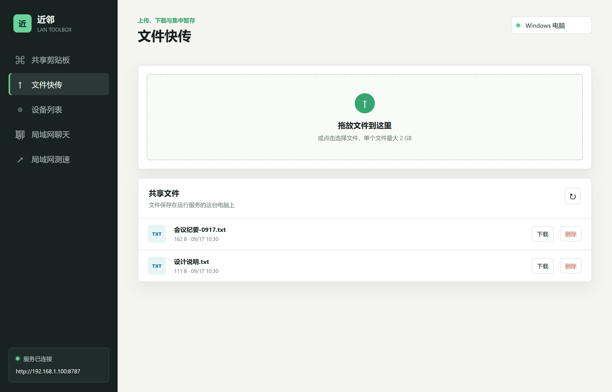
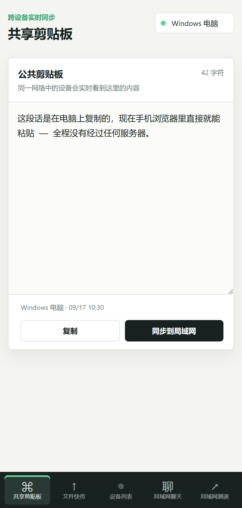
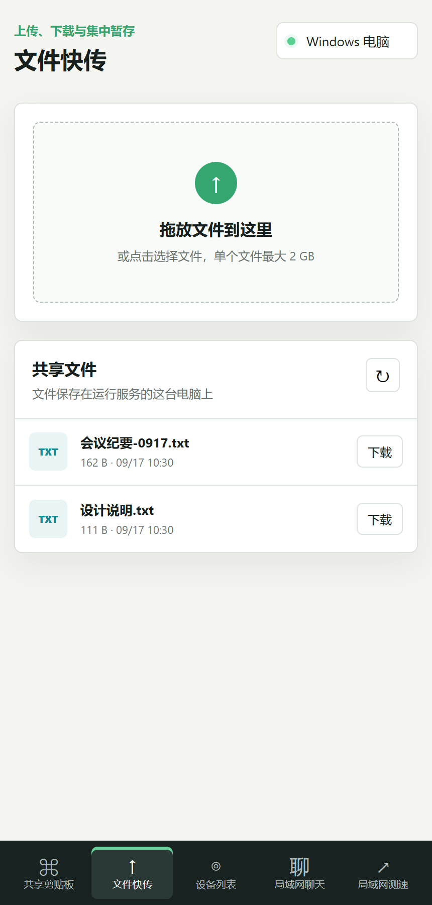

# Nearby LAN Toolbox

[](LICENSE)
[](https://github.com/TuTuBug/NearbyLanToolbox/releases)
[](https://github.com/TuTuBug/NearbyLanToolbox/releases)


English | [简体中文](README.md)

**Scan a QR code on your phone and transfer files to your computer over the same Wi-Fi. Nothing to install on the receiving side.**

The host starts an HTTP server on local port `8787`. Any phone, tablet, or computer on the same Wi-Fi can open the LAN address in a browser (or scan the QR code) to **transfer files**, **share a clipboard**, **chat in a room**, **run a speed test**, and **list the devices on the LAN**.

There are two ways to run the host, with **identical functionality**:

| How to run | Platform | Notes |
|---|---|---|
| **Single-file exe** (recommended) | Windows 10 / 11 | ~1.5 MB, double-click to run, no Node.js required, UI hosted in WebView2, no console window |
| **Node.js version** | macOS / Linux / Windows | Requires Node.js 18+, one command to start, macOS users can double-click `start-mac.command` |

Both sides share the same HTTP API and the same front-end page. **Any device can act as a "client"** — phone, tablet, another computer — just open the address in a browser and you are in. Nothing to install.
**All data stays inside the local network. Nothing passes through any server.**



## Why use it

| | Nearby LAN Toolbox | LocalSend | Snapdrop-style web apps | WeChat File Transfer |
|---|---|---|---|---|
| App needed on the receiving side | ❌ Scan and use the browser | ✅ Required | ❌ Just open a page | ✅ Required |
| Internet access needed | ❌ LAN only | ⚠️ Same Wi-Fi is enough | ✅ Required | ✅ Required |
| Files pass through a server | ❌ Never | ❌ No | ✅ Relayed | ✅ Tencent servers |
| Clipboard sync | ✅ | ❌ | ❌ | ⚠️ Manual forwarding |
| Chat / speed test / device discovery | ✅ | ❌ | ❌ | ❌ |
| Cross-platform | ✅ All three OSes can host | ✅ All platforms | ✅ | ✅ |
| Setup cost | Double-click one exe / one `node` command | Install once per device | Open a page | Install WeChat |

Best for: **you have a computer and a phone at home or in the office, you want to move files between them quickly, and you do not want to install anything just for that.**

<p align="center">
  
  &nbsp;&nbsp;
  
</p>

<p align="center"><sub>Mobile side: open the LAN address (or scan the QR code) in a browser — no app to install</sub></p>

## Download

If you would rather not build it yourself, grab a prebuilt package:

| Platform | Download | What to do next |
|---|---|---|
| **Windows 10 / 11** | **[⬇ NearbyLanToolbox.exe](https://github.com/TuTuBug/NearbyLanToolbox/releases/latest/download/NearbyLanToolbox.exe)** | Portable single file, ~1.5 MB. **Double-click and go** — nothing to install |
| **macOS** | **[⬇ NearbyLanToolbox-mac.zip](https://github.com/TuTuBug/NearbyLanToolbox/releases/latest/download/NearbyLanToolbox-mac.zip)** | Unzip, then **double-click `start-mac.command`**; the browser opens the toolbox automatically |
| **Linux** | **[⬇ NearbyLanToolbox-linux.tar.gz](https://github.com/TuTuBug/NearbyLanToolbox/releases/latest/download/NearbyLanToolbox-linux.tar.gz)** | Unzip, then run `./start-linux.sh` |

All releases: [Releases](https://github.com/TuTuBug/NearbyLanToolbox/releases).

The only prerequisite for the macOS / Linux packages is **Node.js 18 or newer** (a one-time install). The packages themselves have **zero third-party dependencies — no `npm install` needed**. If Node is missing, that is fine too: `start-mac.command` detects it, opens the Node.js download page for you, and continues once you press Enter after installing.

> Why is there no single-file executable for Mac like there is for Windows?
> Native macOS binaries must be compiled and code-signed on macOS; that cannot be produced on Windows.
> The cross-platform packages therefore use "archive + one-click start script". Unzip, double-click — the experience is practically the same.

Runtime requirements for the Windows version:

- Windows 10 1809+ / Windows 11
- .NET Framework 4.8 (bundled with Windows 10 1903+ and Windows 11)
- WebView2 Runtime (bundled with Windows 11 and most Windows 10 builds; if startup reports it missing, install
  [Microsoft Edge WebView2 Runtime](https://developer.microsoft.com/microsoft-edge/webview2/) once)

> Want to build it yourself? See [Building from source](#building-from-source).

## Features

- Shared clipboard (real-time sync over SSE, with heartbeat polling as a fallback)
- Fast file transfer (drag-and-drop upload, download, delete; no per-file size limit, only limited by the free space on the receiving disk)
- Device list (toolbox clients currently online + the system ARP cache)
- LAN chat room (real-time messages over SSE, keeps the latest 200 messages of the current run)
- LAN speed test (latency, upload, download)
- Connection QR code and an optional access password
- Cross-platform: macOS / Linux use the Node.js version, with identical APIs and features
- Windows system tray mode (exe version only)

## Usage

### Windows exe version

Just double-click `NearbyLanToolbox.exe`. From the top of the window you can:

- See service status, the number of online devices, and the LAN address
- Copy the address that other devices on the same Wi-Fi should use
- Show the connection QR code, and turn the access password on or off
- Open the upload folder / change the upload folder
- Reload the embedded page
- Stop or restart the LAN service
- Minimize or maximize the window
- Clicking the close button hides the app to the system tray; choose "Exit" in the tray menu to quit completely

Double-click the tray icon to restore the window; right-click it to copy the address, open the folder, or exit.
If the window ever becomes invisible, run `stop.bat`.

### Connecting by QR code and the access password

Click "Connection QR code" at the top of the app, and a phone or another computer can scan it to open the LAN address directly.

- The access password is off by default, so a scanned device can start using it immediately.
- You can tick "Enable access password" and set a 4-to-8 digit PIN, or click "Generate random".
- Once enabled, remote devices must enter the password before they can use the clipboard, files, chat room, device list, and speed test.
- The QR code only contains the LAN address; the access password is never written into it.
- The local app window connects over the loopback address, so it never asks for the password.

> **The Node.js version behaves the same, it just has no QR code button**: send the other party the LAN address printed at startup
> (something like `http://192.168.1.5:8787`). To set the access password, run
> `node server.js --set-password 1234`. For all command-line options see
> [Running on macOS / Linux](#running-on-macos--linux).

Access settings are stored in:

```text
%LOCALAPPDATA%\NearbyLanToolbox\access-settings.txt
```

### Upload folder

On first run, files are saved to `C:\Users\<your-username>\Downloads\data\uploads`.
Click "Open folder" to browse the files; click "Change folder" to pick another directory. The path is remembered.

```text
%LOCALAPPDATA%\NearbyLanToolbox\upload-path.txt
```

## Running on macOS / Linux

macOS and Linux use the Node.js backend, with **exactly the same API as the exe version** (file transfer, clipboard, chat room, device discovery, speed test, access password), and the very same front-end page.

### Quick start (prebuilt package, recommended)

1. Download the matching archive from [Releases](https://github.com/TuTuBug/NearbyLanToolbox/releases/latest)
   (`NearbyLanToolbox-mac.zip` for macOS, `NearbyLanToolbox-linux.tar.gz` for Linux)
2. Unzip it into a `NearbyLanToolbox` folder
3. **Double-click `start-mac.command`** (on Linux, run `./start-linux.sh`)

The script takes care of the whole chain automatically:

```
Check Node.js ──missing──► open the nodejs.org download page ──► wait for install, press Enter
     │installed
     ▼
Check whether the port is taken ──taken──► automatically try 8788 / 8789…
     ▼
Start the service ──► wait until ready ──► open the toolbox in your default browser
```

On the very first double-click you may see "cannot be opened because it is from an unidentified developer". Just **right-click the file → Open → click Open again** in the dialog. This is needed only once.

The archive ships `使用说明-必读.txt` (Chinese only) with step-by-step instructions for non-technical users — how to connect from a phone, how to allow it through the firewall, how to keep it running in the background. You can forward it to colleagues directly.

### Running from source

```bash
git clone https://github.com/TuTuBug/NearbyLanToolbox.git
cd NearbyLanToolbox
./start-mac.command      # macOS
./start-linux.sh         # Linux
node server.js           # or run the backend directly
```

Requires **Node.js 18 or newer**:

- macOS: `brew install node`, or grab the installer from [nodejs.org](https://nodejs.org)
- Linux: `sudo apt install nodejs` / `sudo dnf install nodejs`, or install via nvm

**Zero third-party dependencies — no `npm install` needed.**

> When launched by double-click, the start scripts prepend `/usr/local/bin`, `/opt/homebrew/bin` and friends to `PATH`,
> so you never hit the classic "works in the terminal, but double-click says node not found".

### Command-line options

| Option | Description |
|---|---|
| `--port <port>` | Service port, default `8787` |
| `--upload-dir <path>` | Upload folder, default `data/uploads` inside the project |
| `--set-password <pin>` | Set the access password (4 to 8 digits), then exit |
| `--disable-password` | Turn the access password off, then exit |
| `--show-config` | Print the current configuration (platform, settings dir, upload dir, port, password status) |
| `--help` | Show help |

```bash
node server.js --set-password 1234    # enable the access password
node server.js                        # start the service (the password now applies)
node server.js --show-config          # show the current configuration
node server.js --disable-password     # disable the access password
node server.js --port 8888            # use another port
```

You can also override the port and upload folder with the `PORT` and `UPLOAD_DIR` environment variables.

### Configuration file locations

The settings directory follows each platform's standard location and uses the **same name and format** as the exe version, so the two platforms never interfere with each other:

| Platform | Settings directory |
|---|---|
| macOS | `~/Library/Application Support/NearbyLanToolbox` |
| Linux | `$XDG_CONFIG_HOME/NearbyLanToolbox` (or `~/.config/NearbyLanToolbox`) |
| Windows | `%LOCALAPPDATA%\NearbyLanToolbox` |

Two files live there:

- `access-settings.txt` — the access password. The first line is `1` for enabled or `0` for disabled; the second line is the PIN.
- `upload-path.txt` — the upload folder (optional; if absent, `data/uploads` inside the project is used).

### Two things to know on first run

- **macOS asks whether to allow `node` to accept incoming network connections — choose "Allow"**,
  otherwise phones and other devices cannot connect. If you accidentally deny it, go to
  System Settings → Network → Firewall → Options and set `node` to allow incoming connections.
- The service window must stay open. Press **Control + C** to stop it.

## Building from source

### Requirements

| Dependency | Notes |
|---|---|
| Windows | 10 / 11 |
| Visual Studio 2022 or newer, or Visual Studio Build Tools | The ".NET desktop build tools" workload is enough — no full IDE needed |
| PowerShell 5.1 | Included with Windows |
| Network | The first build downloads dependencies (a proxy is fine) |

> The target framework is **.NET Framework 4.8**. If the ".NET Framework 4.8 Developer Pack" is not installed,
> the build script downloads the official reference assemblies automatically — **no administrator rights and no installation needed**.

### Build steps

```powershell
git clone https://github.com/TuTuBug/NearbyLanToolbox.git
cd NearbyLanToolbox

# One command does it all: restore dependencies -> compile
powershell -ExecutionPolicy Bypass -File build.ps1
```

Behind a proxy where NuGet is unreachable:

```powershell
powershell -ExecutionPolicy Bypass -File build.ps1 -Proxy "http://127.0.0.1:7897"
```

Output:

```text
outputs\NearbyLanToolbox.exe
```

### Front-end assets are embedded into the exe

The pages are not read from disk. Everything under `public\` is GZip-compressed, Base64-encoded, and written into
`native\EmbeddedAssets.g.cs`, which is compiled into the exe.

`build.ps1` regenerates that file on every build, so normally you never think about it.
Only if you bypass `build.ps1` and call MSBuild directly do you need to run this first:

```powershell
powershell -ExecutionPolicy Bypass -File tools\embed-assets.ps1
```

### Source files must be UTF-8 **with BOM** (read this before editing code)

`native\*.cs` and `*.csproj` contain Chinese text, and those files **must be UTF-8 with BOM**.

The reason: when csc reads a source file **without** a BOM, it decodes it using the **system ANSI code page** instead of UTF-8:

| Build machine | Default code page | Result |
|---|---|---|
| Chinese Windows | CP936 (GBK) | UTF-8 Chinese bytes are decoded as different characters — **the build still succeeds**, only the text is garbled |
| English / other locales (including the GitHub Actions runner) | CP1252 | Some bytes in the UTF-8 Chinese sequences are undefined in CP1252, so decoding fails → **the build breaks** |

This is the classic "builds locally, fails on CI" trap, and the error surfaces deep inside the compiler, so encoding is the last thing you would suspect.

The project already has three layers of protection — keep this in mind when adding files:

1. `native\*.cs` and `*.csproj` all carry a BOM
2. `<CodePage>65001</CodePage>` is set in the csproj
3. `tools\embed-assets.ps1` writes `EmbeddedAssets.g.cs` as UTF-8 **with BOM**

If you add a C# source file containing Chinese text, save it as "UTF-8 with BOM" (in VS Code, pick
`UTF-8 with BOM` from the encoding indicator in the bottom-right corner before saving).

### Restoring dependencies separately

```powershell
powershell -ExecutionPolicy Bypass -File tools\fetch-deps.ps1
```

This downloads the following into `deps\` (already ignored by `.gitignore`):

- The managed assemblies and the x64/x86 native loaders for `Microsoft.Web.WebView2` 1.0.2535.41
- `ZXing.Net` 0.16.10
- The .NET Framework 4.8 reference assemblies (**always downloaded**, regardless of whether the Developer Pack is installed —
  so the build inputs are identical on every machine)

## Project layout

```text
NearbyLanToolbox/
├── build.ps1                     One-command Windows exe build (restore deps + embed front end + compile)
├── start.bat / stop.bat          Windows start / stop (stop kills the process holding port 8787)
├── start-mac.command             macOS double-click launcher (checks Node / port, opens the browser)
├── start-linux.sh                Linux launcher (same, run from a terminal)
├── 使用说明-必读.txt               Guide for non-technical users, shipped inside the cross-platform packages
├── server.js                     Node.js backend entry point (cross-platform: macOS / Linux / Windows)
├── lib/
│   ├── access.js                 Access password and authorization checks (shares the settings format with the exe)
│   └── arp.js                    Neighbor table parser (Windows / macOS / Linux output formats)
├── public/                       Front-end source (shared by both backends; build.ps1 re-embeds it automatically)
│   ├── index.html
│   ├── app.js
│   └── styles.css
├── native/                       Windows exe version (C# / .NET Framework 4.8 / WinForms)
│   ├── NearbyLanToolbox.csproj   Build project
│   ├── Server.cs                 Embedded HTTP server + application entry point (Program.Main)
│   ├── MainForm.cs               WinForms main window, tray, QR code dialog
│   ├── WebViewRuntime.cs         Embedded dependency loading (AssemblyResolve) and native loader extraction
│   ├── EmbeddedAssets.g.cs       Generated: embedded pages / scripts / styles (do not edit by hand)
│   └── app.ico                   Application icon
├── tools/
│   ├── fetch-deps.ps1            Restore Windows build dependencies into deps\
│   ├── embed-assets.ps1          Regenerate EmbeddedAssets.g.cs (called automatically by build.ps1)
│   ├── verify-embedded-assets.js Verify embedded assets match public\ (independent CI gate)
│   ├── pack-release.py           Package the macOS / Linux release archives into outputs/
│   ├── test-arp-parser.js        Neighbor table parser tests (with real macOS / Linux samples)
│   └── test-access.js            Access password and authorization tests
├── .github/workflows/release.yml Build on every push to main; push a tag to also publish a Release
├── start-mac.command             macOS one-click launcher (fixes PATH, finds Node, picks a port)
├── start-linux.sh                Linux one-click launcher
├── 使用说明-必读.txt               Unzip / firewall / connection instructions for end users
├── docs/screenshots/             UI screenshots
├── package.json
└── deps/                         Generated during the Windows build, not committed
```

### Cutting a release

```bash
python tools/pack-release.py          # produces both the mac zip and the linux tar.gz
python tools/pack-release.py mac      # macOS package only
```

Artifacts land in `outputs/`. The packaging script only collects files needed at runtime and **explicitly sets the Unix execute bit** —
that step matters: without it, `start-mac.command` has no execute permission after unzipping on macOS and double-clicking fails immediately.

Pushing a tag matching `v*` triggers GitHub Actions, which builds the exe + mac zip + linux tar.gz and creates a Release for all three platforms at once:

```bash
git tag v1.0 && git push origin v1.0
```

> **Do not delete and recreate the same tag**: the published Release disappears together with the tag (we hit this ourselves).
> To re-release, push a new tag. Pushing `main` only builds and does not publish, which is handy for repeatedly verifying the build pipeline.
>
> **Another trap: `gh release create <tag>` silently creates a tag pointing at the current HEAD of the default branch when the tag does not exist.**
> If the release job is given a wrong tag name (for example one referencing an old tag that no longer exists), you end up with an extra
> tag and Release that "points at the latest code but carries an old version number" — correct content, wrong name.
> After releasing, always verify with `git ls-remote --tags origin` and open
> `/releases/tag/<your-version>` to confirm the page exists.
>
> Build logs (dependency layout, embedded asset verification, MSBuild output) are pushed to `build.log` on the `ci-logs` branch.
> You can read them from the raw URL without logging in to GitHub. `ci-logs/README.md` records the `ref` and `sha` of the most recent build —
> the fastest way to answer "which ref actually triggered this run".

> **About the two backends**: `native/` is the Windows single-file exe (C# / WinForms), `server.js` is the cross-platform
> Node.js version. They expose **the same HTTP API** and share the single front end under `public/`, and behave identically.
> The only difference is how they run — the exe has a native window and a system tray, the Node.js version is a command-line
> program whose UI opens in your browser.
>
> Running the tests verifies the cross-platform parsing and authorization logic:
>
> ```bash
> npm test        # equivalent to node tools/test-arp-parser.js && node tools/test-access.js
> ```

## How the single file is produced

Understanding this is what keeps you out of trouble when changing the build configuration:

1. `tools\fetch-deps.ps1` restores assemblies such as WebView2 and ZXing into `deps\`.
2. `native\NearbyLanToolbox.csproj` declares them as `<EmbeddedResource>` with a `LogicalName` for the resource name,
   for example `NearbyLanToolbox.zxing.dll`. These assemblies are compiled with `Private=false` and are
   **not copied to the output directory**.
3. At startup, `WebViewRuntime.Initialize()` registers an `AppDomain.AssemblyResolve` handler that loads each dependency
   on demand from its resource stream via `Assembly.Load`.
4. `WebView2Loader.dll` (a native DLL, which cannot go through `Assembly.Load`) is extracted to
   `%LOCALAPPDATA%\NearbyLanToolbox\runtime\1.0.2535.41\{x64,x86}\` and then registered with `SetDllDirectory`.

Therefore **the resource names hard-coded in `WebViewRuntime.cs` must match the `LogicalName` values in the csproj exactly**.
Renaming one without the other makes the app report a missing embedded component at startup.

## FAQ

**Build fails with MSB3644 "Reference assemblies for .NETFramework,Version=v4.8 were not found"**
Dependencies were not fully restored. Run `tools\fetch-deps.ps1` (or run `build.ps1` without `-SkipDeps`).

**Build fails with `HttpUtility` / `JavaScriptSerializer` not found**
The project must reference `System.Web` (`HttpUtility`) and `System.Web.Extensions` (`JavaScriptSerializer`). Neither can be omitted.

**The build succeeds but the exe cannot open its embedded components**
Check that the resource name strings in `WebViewRuntime.cs` match the csproj `LogicalName` values character for character.

**Port 8787 is already in use**
For the exe version run `stop.bat`; for the Node.js version pick another port: `node server.js --port 8888`.
Or find the PID with `netstat -ano | findstr 8787` (macOS / Linux: `lsof -i :8787`) and end it manually.

**A phone cannot connect on macOS**
On first launch macOS asks whether to allow `node` to accept incoming network connections — choose **Allow**.
If you denied it by mistake, go to System Settings → Network → Firewall → Options and allow incoming connections for `node`.

**The device list is empty on macOS**
The device list is read from the local ARP cache, which only contains devices that communicated recently. Right after boot,
or if this machine has never talked to other devices, it will be empty. Access the toolbox once from your phone, then hit "Rescan".

## System requirements and caveats

- 32-bit and 64-bit Windows are supported, and Microsoft Edge WebView2 Runtime is required.
  Windows 11 and most Windows 10 installations that still receive updates already include it.
- macOS / Linux run the Node.js version and need Node.js 18 or newer; Windows can use either approach.
- On macOS, the first run must be allowed to accept incoming connections for `node`, otherwise other devices cannot connect.
- On the first run in Windows, the firewall may ask for permission — allow **private networks only**.
- The EXE is currently not code-signed. If SmartScreen warns about an unknown publisher, verify where the file came from before running it.
- With the access password disabled, any LAN device that opens the address can operate the shared content. Only run it on a trusted network.
- The ARP list is this machine's recent-communication cache, not the router's full list of online devices.
- Guest Wi-Fi, campus networks, or networks with AP isolation enabled may block device-to-device traffic.

## License

[MIT](LICENSE)
